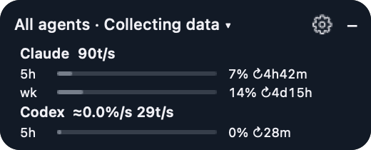

# QuotaPilot

[](https://github.com/dwagwd/quotapilot/tags) [](LICENSE)  

**Know how much Codex and Claude Code quota you have left before you hit the limit.** QuotaPilot is a small, native macOS desktop widget for **plan quota**, **account token consumption**, and **reset countdowns** across Codex, Claude Code, Antigravity, Cursor and DeepSeek, plus token usage from Gemini CLI and Grok CLI. Built with AppKit and Swift, without a browser runtime or model-turn polling.



```sh
brew tap dwagwd/quotapilot https://github.com/dwagwd/quotapilot
brew install dwagwd/quotapilot/quotapilot
open "$(brew --prefix quotapilot)/QuotaPilot.app"
```

Homebrew builds QuotaPilot from source on your Mac (about two minutes, needs the Xcode Command Line Tools); update with `brew upgrade quotapilot`. No prebuilt binaries are published.

<!-- sponsor:start --><!-- sponsor:end -->

[繁體中文](README.zh-TW.md) · [AI Quota Watch website](https://aiquotawatch.pages.dev/) ([source](site/)) · [Privacy](PRIVACY.md) · [Contributing](CONTRIBUTING.md) · [MIT license](LICENSE)

Unofficial community project. Not affiliated with or endorsed by OpenAI, Anthropic, Google, or Cursor. Product names belong to their respective owners.

## Features

- Draggable 260 × 128 pt card; collapsible 182 × 32 pt capsule, with a settings gear in both modes.
- Separate plan-quota and Codex account token rates. Compact `%/h` notation means percentage points per hour (20% → 25% in one hour = 5%/h).
- Keep one selected quota or add up to four additional quotas. The card grows vertically; collapse returns to one compact capsule.
- Custom text/background RGB values (0–255) or automatic system appearance.
- Energy saver: 120-second network polling and 15-second display updates. Hidden cards stop the UI timer; rate calculations are cached until new samples arrive.
- Optional Claude Code and Antigravity CLI status-line bridges; Cursor Teams on-demand spend-cap collector. [Provider support and setup](docs/providers.md)
- **Quota order** (Settings): sort agents by detection order, usage, next reset or name, and pin one agent to the top.
- **Task routing rules**: pick who handles web/research, review, planning and implementation (Codex, Claude or Automatic), with automatic fallback when that agent is low on quota.
- **Orchestrator mode** (Agent collaboration…): one agent plans and verifies while the other only implements — Claude Code → Codex (`orchestrate-codex`) or Codex → Claude Code (`orchestrate-claude`), with up to three fix rounds and quota checks.
- **Card style** (Settings): Detailed, Compact (one line per agent with every limit, rate and tokens; total usage in the title) or Bars (one small bar per limit).
- **Agent collaboration** (menu bar → Agent collaboration…): choose a `codex-review` skill for Claude Code (independent read-only review via `codex exec`), a `claude-review` skill for Codex (review via `claude -p` in plan mode), and, separately, Codex access to Claude Code's tools over MCP. A **quota router** (Automatic / Codex first / Claude first) weighs every 5-hour and weekly window and their reset times; skills consult it before delegating and never delegate twice.
- **Usage statistics** window (menu bar → Usage statistics…): 24h / 7d / 30d token totals and tokens per hour, curves per provider, and quota-used curves with the average percentage points consumed per hour. The first launch backfills 30 days from local logs.
- **All agents** row: total tokens across Codex and Claude Code (plus DeepSeek, Kimi, GLM or Qwen models used through Claude Code) read from local session logs, with an input / cache read / cache write / output / reasoning breakdown per provider in the tooltip. Only token counts are read; turn it off in Settings.
- **Updates** (menu bar): checks GitHub's version tags once a day (turn off with **Check for updates automatically**) and notifies once per new version; update with `brew upgrade quotapilot`.
- **Share anonymous stats daily** (menu bar, off by default): once a day sends the same numbers `quotapilot share` previews to [AI Quota Watch](https://aiquotawatch.pages.dev/) anonymously (no account; the collector keeps only a hashed id of this computer). `quotapilot share --yes` does the same from cron or launchd, and `quotapilot share --forget` deletes everything this computer sent.
- Remaining quota and countdown on the reset line (for example `57% left · reset 02:10:00`).
- Optional **auto-continue** for Codex (Settings, off by default): when a quota window that was full resets, the interrupted session is resumed once with `codex exec resume` in its project folder. This starts a model turn using your Codex configuration; output is written to `auto-continue.log`.
- **Agents connect automatically** (Settings → Connect detected agents automatically, on by default): Claude Code and Antigravity quota bridges are installed when those agents are found, and a DeepSeek balance appears when Claude Code is configured for DeepSeek or a key is saved. **Connect agents…** in the menu bar shows the status and does the same manually: connect Claude Code or Antigravity quota with one click, or add a DeepSeek API key (stored in the login keychain) to show the balance.
- Optional quota alerts (Settings → Quota alerts, off by default): one notification per reset cycle when a quota reaches 90% or would run out before reset at the current pace. Requires the installed app bundle.
- Pace forecast: hover the quota rate to see the projected usage at reset, or how long until 100% at the current pace. The rate turns orange when the window would run out before it resets. This is a linear projection, not a promise.
- Observation window: **1 minute to 30 days**, entered as a whole number of minutes, hours, or days.
- Independent rate display unit: per minute, hour, or day.
- English, Traditional/Simplified Chinese, Japanese, Korean, Spanish, French, German, Brazilian Portuguese, Italian, or follow the system language. New task/diagnostic labels are translated in English and Chinese and fall back to English in the other languages.
- Actual backend quota windows and plan names, including distinct model buckets when available.
- Local sample history, saved position/settings, stale-data indicators, automatic reconnection, and manual startup.
- Source diagnostics for Codex and optional bridges; a long-term account usage event ledger for gaps, account switches, resets, and source corrections; and local task records with verification outcomes. Task-specific token attribution stays unavailable unless a source can directly identify a session.

## Windows and Linux: the `quotapilot` CLI

The menu bar app is macOS-only. On **macOS, Linux and Windows** the `quotapilot` command shows the same data and router:

```sh
quotapilot status            # quota per agent, tokens (24 h), routing by task
quotapilot watch             # refresh in the terminal every 60 s
quotapilot route review      # prints codex or claude (exit 3 if both are low)
quotapilot stats --hours 168 # tokens by agent and purpose for 7 days
quotapilot config rule web codex
quotapilot status --json     # for scripts and skills
quotapilot share             # opt-in: preview anonymous speed/quota numbers, then share them with AI Quota Watch
```

On macOS the Homebrew formula puts `quotapilot` on `PATH` (the tool ships inside the app at `QuotaPilot.app/Contents/Helpers/quotapilot`). On Linux and Windows download the single-file build (Linux x64 or ARM64, Windows x64) from the [latest release](https://github.com/dwagwd/quotapilot/releases/latest) and check it against the `.sha256` file next to it, or build it yourself with Swift 6.2 or later: `swift build -c release --product quotapilot` (binary in `.build/release/`). It needs the Codex CLI on `PATH` for Codex quota and an existing Claude Code login for Claude plan usage. Settings are stored in `~/.local/state/quotapilot/cli-config.json` (Linux) or `%LOCALAPPDATA%\QuotaPilot\cli-config.json` (Windows); on macOS the app's settings are used.

## Build and install

Requirements: macOS 13+, Swift 5.9+ / Xcode Command Line Tools, Python 3 for tests and packaging, and Codex desktop or CLI signed in with a ChatGPT account. The core Codex app is native and does not require Python; optional provider bridges use Python 3.

**Quick install:** use the Homebrew commands at the top; they compile and install QuotaPilot on your Mac.

**From source:** clone the repository:

```sh
git clone https://github.com/dwagwd/quotapilot.git quotapilot
cd quotapilot
```

Then build and launch:

```sh
./scripts/check.sh
./scripts/build-install.sh
./scripts/launch.sh
```

The app is installed at `~/Applications/QuotaPilot.app`. Reopening it reveals the existing instance. Turn on **Open at login** in Settings to start it with macOS. Use the menu bar item to hide/show, refresh, pin, or quit.

Click the **gear** to configure language, observation window, rate units, additional quotas, RGB colors, energy saving, and provider imports, then **Apply**. Click the card title to select a quota window. Drag blank space to move the card. Hover over each rate for its source and actual observed duration.

Use the menu bar item to open **Source diagnostics…**, start or finish a Codex task record, review task/event history, or export either ledger. Account-wide quota and token observations stay separate from task consumption; see [the prototype notes](docs/task-ledger.md).

A Codex plugin manifest and launch skill are included. See [Codex plugin setup](docs/plugin.md).

## What the numbers mean

| Metric | Source | Calculation and scope |
|---|---|---|
| Plan quota | `account/rateLimits/read` | Observed percentage-point increase in the selected quota window. The displayed plan is backend-reported. |
| Account tokens | `account/usage/read` → `summary.lifetimeTokens` | Observed increase in the account-wide reported cumulative token counter. This is not a per-model measurement. |
| Reset countdown | `resetsAt` | Time until the backend-provided reset; reaching zero does not assume the reset occurred. |

**Tokens are not converted into quota using fixed multipliers.** Models and plans can consume quota differently. Shared quota buckets do not expose attribution to each model, so the widget reports actual bucket changes and does not label them as one model's usage. A distinct Spark bucket is separate from the main shared Codex bucket.

Rates are estimates: differences are divided by elapsed observation time, including idle time, and scaled to the selected display unit. “Per day” scales the observed pace; it is not a promise of future consumption. The footer shows the requested observation window, and tooltips show each metric's actual observed duration.

The default is the latest hour, shown per hour. Warmup requires the shorter of 5 minutes or the requested window. Shorter-than-requested observations are labeled estimates. No historical samples are invented when extending the window. Counters can update late; zero token rate means no reported increase, not proof of zero model activity.

Quota resets, decreases, plan changes, account switches, clock reversal, or gaps over 5 minutes restart the affected observation segment. Token counter corrections and account switches similarly restart token observation. Up to 31 days of samples are kept while collecting; stopped or offline installations retain their last files until collection resumes or the files are removed. An interrupted multi-day session therefore does not produce a continuous multi-day rate.

Missing or unsupported token data shows `—` while quota continues to work. API-key-only accounts may not expose these ChatGPT usage endpoints. Codex authentication stays with Codex; the widget never reads or copies authentication files or starts model turns.

## Development and packaging

```sh
./scripts/check.sh     # Swift tests + source export hygiene
./scripts/build.sh     # Build/sign locally, without installing
./scripts/package.sh   # Architecture-specific app ZIP + portable source ZIP
```

Builds use `~/Library/Caches/QuotaPilot/` by default. Override `QUOTAPILOT_BUILD_CACHE`, `QUOTAPILOT_TEST_CACHE`, or `QUOTAPILOT_DIST_DIR` as needed. `CODEX_USAGE_CODEX_PATH` selects a custom Codex executable when launching the native executable directly.

Builds are ad-hoc signed on the machine that compiles them (set `QUOTAPILOT_SIGN_IDENTITY` to sign with your own Developer ID). From 0.6.3 no prebuilt app is published: Homebrew and `./scripts/build.sh` compile it locally. The manual GitHub Actions packaging workflow only creates ad-hoc artifacts for testing. [Release checklist](docs/releasing.md)

## Local data and removal

Samples and diagnostic snapshots are stored in `~/Library/Application Support/QuotaPilot/`. Preferences use the `io.github.dwagwd.quotapilot` defaults domain. Avoid uploading these files or unredacted screenshots to public issues.

To remove: quit the widget, remove its app, optionally remove its local data and preferences, and remove the plugin from Codex if installed. No daemon is installed; a login item exists only if you turn on **Open at login**.

## Status

Version 0.5.0 (QuotaPilot) adds the cross-platform `quotapilot` CLI for macOS, Linux and Windows. From 0.6.3 QuotaPilot is distributed as source only and compiled by Homebrew on your Mac. Codex is the live-tested provider. Optional Claude/Antigravity/Cursor bridges are experimental and fixture-tested; see their support boundaries before setup. CI tests and builds on macOS 15 (GitHub no longer offers macOS 14 runners), Linux x64 and ARM64, and Windows x64. See [validation scope](docs/validation.md) for local checks and limitations.
