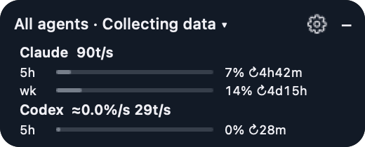

# QuotaPilot

[](https://github.com/dwagwd/quotapilot/releases/latest) [](LICENSE)  

**在撞到上限之前，就知道 Codex 和 Claude Code 還剩多少額度。** 原生 macOS 桌面小卡與選單列圖示，另有可在 macOS、Linux、Windows 使用的 `quotapilot` 指令。顯示每個 5 小時與每週窗口用了多少、消耗速度多快、什麼時候重置。



```sh
brew tap dwagwd/quotapilot https://github.com/dwagwd/quotapilot
brew install dwagwd/quotapilot/quotapilot
open "$(brew --prefix quotapilot)/QuotaPilot.app"
```

Apple Silicon 且 macOS 15 以上的 Mac，Homebrew 會直接安裝預先編譯的套件，幾秒完成。其他 Mac 會從原始碼編譯（約兩分鐘，需要 Xcode Command Line Tools）。之後用 `brew upgrade quotapilot` 更新。

<!-- sponsor:start --><!-- sponsor:end -->

**[AI Quota Watch](https://aiquotawatch.pages.dev/zh/)** 是本專案的網站：ChatGPT、Claude、Gemini、Grok 的方案額度、重置紀錄與社群實測速度，每個數字都附來源（[網站原始碼](site/)）。

[English](README.md) · [完整功能](docs/features.zh-TW.md) · [隱私](PRIVACY.md) · [其他 agent 連接指南](docs/providers.md) · [MIT 授權](LICENSE)

非官方社群專案，與 OpenAI、Anthropic、Google、Cursor 無隸屬或背書關係。

## 為什麼用 QuotaPilot

- **原生、輕量。** 使用 AppKit 與 Swift，沒有瀏覽器執行環境。本機一分鐘的量測約使用 27 MiB 記憶體、單核 0.05% CPU（[量測方式](docs/validation.md#resource-measurement)）。
- **先問再做。** 第一次啟動會先詢問，才讀取 Claude Code 存在本機的登入資訊或修改其他 agent 的設定檔。只看 Codex 額度兩者都不需要。
- **沒有你的同意，資料不會離開你的 Mac。** 沒有遙測。匿名分享預設關閉，送出前會顯示完整內容，之後可以刪除。[隱私說明](PRIVACY.md)
- **不會花掉你的額度。** 只讀取用量，不會自行啟動模型對話（除非你開啟自動續跑），也不會兌換重置額度。

## 功能

**看額度**
- Codex 與 Claude Code 每個 5 小時與每週窗口的方案額度、剩餘百分比與重置倒數。
- 可選：Antigravity、Cursor Teams 額度與 DeepSeek 餘額；Gemini CLI 與 Grok CLI 的 token 用量。
- 可拖曳的小卡，可收合成小膠囊，有詳細、精簡、進度條三種樣式，最多同時顯示五個額度。

**用完之前先知道**
- 每小時消耗幾個百分點，以及照目前速度到重置時會用到多少。
- 可選的提醒：用到 90%，或照目前速度會在重置前用完時通知。
- 可選的自動續跑：窗口重置後接續被中斷的 Codex 工作。

**把工作交給還有額度的 agent**
- 額度路由：網路研究、審查、規劃、實作各自指定 Codex 或 Claude，額度不足時自動改派。
- 審查與 orchestrator skill：一個 agent 規劃與驗收，另一個實作。
- `quotapilot route review` 會印出該用哪個 agent，方便寫進自己的腳本。

**回頭看**
- 24 小時、7 天、30 天的用量統計，依 agent 與模型列出 token。
- 本機任務紀錄與帳號事件紀錄，可以匯出。

十種介面語言。完整列表見 [docs/features.zh-TW.md](docs/features.zh-TW.md)。

## 建置與安裝

需要 macOS 13+、Swift 5.9+／Xcode Command Line Tools、測試用 Python 3，以及已登入 ChatGPT 帳號的 Codex App 或 CLI。Codex 核心小卡不依賴 Python，其他 agent 橋接需要 Python 3。

**Windows／Linux：`quotapilot` 命令列工具。**選單列 App 只支援 macOS；在 macOS、Linux、Windows 都可以用 `quotapilot status`（各 agent 額度、24 小時 Token、依工作分派）、`quotapilot watch`（終端機即時更新）、`quotapilot route review`（輸出 codex 或 claude）、`quotapilot stats --hours 168`、`quotapilot config rule web codex`，加上 `--json` 可供腳本與 skill 使用。macOS 上 Homebrew 會把 `quotapilot` 放進 `PATH`（工具位於 `QuotaPilot.app/Contents/Helpers/quotapilot`）；其他平台以 Swift 6.2 以上執行 `swift build -c release --product quotapilot` 建置。

**快速安裝：**使用上方的 Homebrew 指令。

**從原始碼建置：**先執行 `git clone https://github.com/dwagwd/quotapilot.git quotapilot`，再 `cd quotapilot`。

```sh
./scripts/check.sh
./scripts/build-install.sh
./scripts/launch.sh
```

安裝於 `~/Applications/QuotaPilot.app`。重複啟動只顯示原本的小卡；不設定登入自動啟動。齒輪可調整偏好設定；點標題切换主額度，拖曳空白處移動。滑鼠停在速度上可查看實際觀測長度與定義。

從選單列開啟「資料來源診斷」、開始／結束 Codex 任務紀錄、查看任務／用量事件或分別匯出兩種帳本。額度與帳號 Token 快照會和任務消耗分開保存；詳見[帳本原型說明](docs/task-ledger.md)。

## 數據定義

Codex 額度來自 `account/rateLimits/read`，tokens 來自 `account/usage/read` 的帳號累積回報。兩者獨立計算，不能用固定倍率互換。共享額度無法拆成各模型消耗；Spark 等獨立窗口則分開顯示。Token 回報可能延遲，速度 0 代表未回報增加。

預設觀測最近一小時。暖機需 5 分鐘或所選較短期間；不足完整期間顯示估算。重置、用量下降、帳號或方案切換、時鐘倒退、超過五分鐘中斷均重設基準。Codex 取樣時保留最近最多 31 天；停止時既有檔案會留到下次取樣或手動移除。多日估算需要連續觀測。Bridge 的速度歷史目前保存在記憶體，重開小卡會重新累積。

倒數歸零只表示等待來源確認；缺少資料顯示「—」。Claude／Antigravity 需要 CLI 回報，靜置或退出超過五分鐘會標記過期。其他 agent 的 context window 不被當成累積 token 消耗量。

## 開源準備

採 MIT。包含貢獻、安全回報、隱私、變更記錄、CI、手動打包 workflow 與來源匯出檢查。v0.5.0 更名為 QuotaPilot，並新增可在 macOS、Linux、Windows 使用的 `quotapilot` 命令列工具。不發布簽章的 App；唯一預先編譯的 macOS 套件是在 GitHub 的機器上建置的 Homebrew bottle。Codex 已實測；其他 agent 橋接仍屬實驗性功能，通過資料格式測試但尚未完成真實帳號驗證。

```sh
./scripts/package.sh
```

產出與建置快取預設在 `~/Library/Caches/QuotaPilot/`。發布步驟見 [releasing.md](docs/releasing.md)，測試範圍見 [validation.md](docs/validation.md)。

本機採樣在 `~/Library/Application Support/QuotaPilot/`，偏好設定屬於 `io.github.dwagwd.quotapilot`。請勿將這些個人資料推送至 GitHub。移除時先退出 App；如有安裝其他 agent 橋接，依連接指南還原 statusLine 設定，再移除 App、資料及插件。

命令列工具會遵守 macOS App 已儲存的資料讀取選擇。獨立安裝 CLI 時，請用 `quotapilot config claude-plan on` 同意讀取 Claude Code 登入；用 `quotapilot config agent-logs off` 可停用本機記錄掃描。
